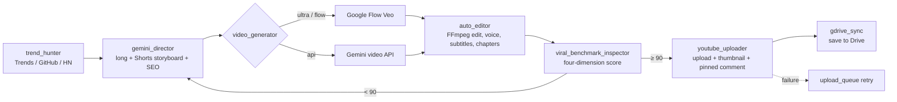

**Windows quick start: [Download ZIP](https://github.com/tonykfr1234/yt-auto-empire/archive/refs/heads/main.zip) → extract everything → double-click `INSTALL.bat`.**

<p align="center">
  <strong>English</strong> · <a href="README.zh-TW.md">繁體中文</a> · <a href="README.zh-CN.md">简体中文</a>
</p>

<p align="center"></p>
<h1 align="center">Fully Automated YouTube Viral Video Pipeline</h1>
<p align="center">YT-Auto-Empire · Topic discovery → script → video generation → edit and voice-over → quality review → YouTube upload</p>
<p align="center">
  
  
  
  
</p>
<p align="center">
  <a href="#advantages">Advantages</a> · <a href="#quick-start">Quick start</a> · <a href="#workflow">Workflow</a> · <a href="#features">Features</a> · <a href="#demo">Demo</a> · <a href="#faq">FAQ</a> · <a href="#documentation">Documentation</a>
</p>

```powershell
python main_pipeline.py --engine ultra --long-scenes 32 --shorts-scenes 4
```

---

YT-Auto-Empire automates a YouTube channel end to end. It finds topics on Google Trends, GitHub Trending and Hacker News; Gemini acts as director and writes storyboards for both a long video and a Short; Google Flow (Veo) or the Gemini API generates the footage; FFmpeg edits, voices, subtitles and chapters it; and a quality review must score 90+ before anything is uploaded to your channel.

This is an unofficial community project, not affiliated with Google or YouTube.

<a id="advantages"></a>
## All the advantages

| Advantage | What it means |
| --- | --- |
| 🔎 Finds topics automatically | Rotates through Google Trends, GitHub Trending and Hacker News; skips topics already published |
| 🎬 Two formats per topic | Every topic produces a 16:9 long video and a 9:16 Short |
| 💎 Uses Ultra credits fully | `ultra` mode spends Google Flow credits first, then falls back to the Gemini API |
| 🧑‍🎤 Original 3D presenter | 24 original 3D studio scenes keep the same presenter across videos |
| 🎙️ Voice-over and subtitles | Female narration, full-sentence subtitles, background music and auto chapters |
| ✅ Four-dimension review | Scores content, music, visuals and subtitles; only 90+ is released |
| 📤 Upload and monetize | YouTube Data API upload with thumbnail, captions, pinned comment and affiliate links; failed uploads are queued and retried |
| ♾️ Runs 24/7 | `daemon_24_7.py` runs a new cycle every 45 minutes and logs live status |
| ☁️ Syncs to Drive | Long videos, Shorts, project packages and a review folder are filed in Google Drive |

<a id="quick-start"></a>
## Quick start

1. Install **Python 3.12+** (tick "Add to PATH").
2. [Download the ZIP](https://github.com/tonykfr1234/yt-auto-empire/archive/refs/heads/main.zip), extract everything and double-click **`INSTALL.bat`**. It installs packages, the Playwright browser and FFmpeg, and creates `.env`.
3. Open `.env` and fill in `GEMINI_API_KEY` and `YOUTUBE_CHANNEL_EMAIL`. For automatic uploads, also add YouTube's `client_secrets.json`.
4. Double-click **`啟動_Google_Flow_專屬專案綁定.bat`** and **sign in to Google yourself once** in the browser that opens; the session is remembered.
5. Produce your first video:

```powershell
python main_pipeline.py                 # produce only, no upload
python main_pipeline.py --upload        # upload automatically after review passes
python daemon_24_7.py                   # 24/7 mode
```

<a id="workflow"></a>
## Workflow



<a id="features"></a>
## Features

| Module | Behavior |
| --- | --- |
| `trend_hunter.py` | Mines high-CPM topics from Google Trends, GitHub Trending and Hacker News |
| `gemini_director.py` | Writes long and Short storyboards, narration, SEO titles, descriptions and tags |
| `video_generator.py` | Dual engine: Google Flow browser control (Veo highest quality, 1080p) or the Gemini API |
| `ultra_quota_maximizer.py` | Tracks monthly Ultra credits and spreads daily output across the remaining days |
| `auto_editor.py` | FFmpeg mixing, burned-in subtitles and chapters for long videos and Shorts |
| `viral_broll_engine.py` | 3D studio scenes, 60 fps parallax camera moves and glassmorphism subtitle HUD |
| `viral_benchmark_inspector.py` | Content / music / visuals / subtitle scoring |
| `self_critic_and_analytics.py` | Self-review that feeds lessons into an evolution memory for the next run |
| `youtube_uploader.py` | Official API upload; falls back to YouTube Studio without credentials; failures are queued |
| `gdrive_sync.py` | Files results into Google Drive |
| `daemon_24_7.py` | 24/7 loop that picks a fresh topic every cycle |

<a id="demo"></a>
## Demo

Original 3D presenter studio scenes (`assets/studio_art/`, 24 in total):


<a id="faq"></a>
## FAQ

**Q: Do I need Google AI Ultra?**
No. `--engine api` uses only the Gemini API; `ultra` and `flow` need an account with Google Flow access.

**Q: Upload fails because Chrome is locked.**
Your everyday Chrome locks its profile while open. The video goes into the upload queue and is retried automatically.

**Q: Why wasn't the video uploaded?**
Upload is off by default. Add `--upload`, and the review must score 90 or higher.

**Q: Where did the upload history and credit ledger files go?**
They are local runtime state with personal records, so they are no longer committed. They are recreated on first run.

**Q: Will `.env` be uploaded?**
No. `.env`, `token.json` and `client_secrets*.json` are in `.gitignore`.

<a id="documentation"></a>
## Documentation and files

```
yt-auto-empire/
├─ INSTALL.bat                          One-click install
├─ 啟動_Google_Flow_專屬專案綁定.bat      First-time Google sign-in
├─ main_pipeline.py                     Main pipeline (single run)
├─ daemon_24_7.py                       24/7 mode
├─ .env.example                         Settings template
├─ assets/studio_art/                   Original 3D presenter scenes
├─ skills/yt-auto-empire-character-drive/SKILL.md   AI assistant skill
└─ CHANGELOG.md                         Changelog
```

- [Changelog](CHANGELOG.md) · [Contributing](CONTRIBUTING.md) · [Security](SECURITY.md) · [AI assistant skill](skills/yt-auto-empire-character-drive/SKILL.md)

## Usage rules

- Use only material you have rights to; the presenter is an original design and does not imitate real people.
- Before automatic uploads, make sure titles, descriptions and affiliate links follow YouTube policy and local law.
- License: not yet specified.

## Glossary

| Term | Definition |
| --- | --- |
| Google Flow | Google's AI filmmaking tool that generates video from text or images with Veo. |
| Veo | Video generation model developed by Google DeepMind. |
| Gemini API | Google's generative AI API for text, images, speech and video. |
| YouTube Data API v3 | YouTube's official API for uploading videos and setting thumbnails and captions. |
| Playwright | Microsoft's open-source browser automation library. |
| FFmpeg | Open-source audio/video toolkit for transcoding, editing, mixing and subtitle burn-in. |
| CPM (Cost Per Mille) | Ad revenue per thousand impressions, used to judge a topic's earning potential. |
| Shorts | YouTube's vertical short-video format (9:16, up to 60 seconds). |

## References

- Google Flow: <https://labs.google/flow>
- Gemini API docs: <https://ai.google.dev/gemini-api/docs>
- YouTube Data API v3: <https://developers.google.com/youtube/v3>
- Playwright for Python: <https://playwright.dev/python/>
- FFmpeg: <https://ffmpeg.org/>
