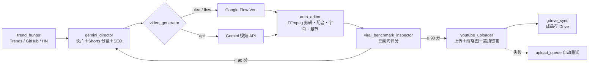

**一键安装：[下载 ZIP](https://github.com/tonykfr1234/yt-auto-empire/archive/refs/heads/main.zip) → 全部解压缩 → 双击 `INSTALL.bat`。**

<p align="center">
  <a href="README.md">English</a> · <a href="README.zh-TW.md">繁體中文</a> · <strong>简体中文</strong>
</p>

<p align="center"></p>
<h1 align="center">YouTube 爆款视频全自动产线</h1>
<p align="center">YT-Auto-Empire · 自动选题 → 写脚本 → 生成视频 → 剪辑配音 → 品质审核 → 上传 YouTube</p>
<p align="center">
  
  
  
  
</p>
<p align="center">
  <a href="#advantages">优点</a> · <a href="#quick-start">快速开始</a> · <a href="#workflow">运作流程</a> · <a href="#features">功能</a> · <a href="#demo">示范</a> · <a href="#faq">常见问题</a> · <a href="#documentation">文档</a>
</p>

```powershell
python main_pipeline.py --engine ultra --long-scenes 32 --shorts-scenes 4
```

---

YT-Auto-Empire 是一条从头到尾自动化的 YouTube 视频产线：自动从 Google Trends、GitHub Trending、Hacker News 找题目，让 Gemini 当导演写长片和 Shorts 双版本分镜，用 Google Flow（Veo）或 Gemini API 生成画面，FFmpeg 自动剪辑、配音、上字幕和章节，最后经过品质审核，分数够高才上传到你的频道。

本项目为非官方社群项目，与 Google、YouTube 没有隶属关系。

<a id="advantages"></a>
## 优点总整理

| 优点 | 说明 |
| --- | --- |
| 🔎 自动找题目 | Google Trends、GitHub Trending、Hacker News 轮流抓，发布过的主题自动跳过 |
| 🎬 一次出两种版本 | 同一个主题同时产出 16:9 长片和 9:16 Shorts |
| 💎 把 Ultra 点数用好用满 | `ultra` 模式优先消耗 Google Flow 点数，用完自动改走 Gemini API |
| 🧑‍🎤 原创 3D 主持人 | 24 组原创 3D 摄影棚场景，每支视频人物一致 |
| 🎙️ 自动配音与字幕 | 女声旁白、整句不切断的字幕、背景音乐、自动章节 |
| ✅ 四面向品质审核 | 内容、音乐、画面、字幕四项评分，90 分以上才放行 |
| 📤 自动上传与变现 | YouTube Data API 上传缩略图、字幕、置顶留言与联盟链接；失败自动排队重试 |
| ♾️ 24 小时常驻 | `daemon_24_7.py` 每 45 分钟自动跑一轮，状态即时写入日志 |
| ☁️ 成品同步 Drive | 长片、Shorts、项目包、检阅文件夹自动分类存到 Google Drive |

<a id="quick-start"></a>
## 快速开始

1. 安装 **Python 3.12 以上**（安装时勾选 Add to PATH）。
2. [下载 ZIP](https://github.com/tonykfr1234/yt-auto-empire/archive/refs/heads/main.zip) 并全部解压缩，双击 **`INSTALL.bat`**。它会安装套件、Playwright 浏览器和 FFmpeg，并创建 `.env`。
3. 打开 `.env`，填入 `GEMINI_API_KEY` 和 `YOUTUBE_CHANNEL_EMAIL`。要自动上传的话，另外放入 YouTube 的 `client_secrets.json`。
4. 双击 **`启动_Google_Flow_专属项目绑定.bat`**，在跳出的浏览器**自己登录 Google 一次**，之后就会记住。
5. 产出第一支视频：

```powershell
python main_pipeline.py                 # 只产片，不上传
python main_pipeline.py --upload        # 审核通过后自动上传
python daemon_24_7.py                   # 24 小时常驻模式
```

<a id="workflow"></a>
## 运作流程



<a id="features"></a>
## 功能

| 模块 | 行为 |
| --- | --- |
| `trend_hunter.py` | 从 Google Trends、GitHub Trending、Hacker News 挖高 CPM 题目 |
| `gemini_director.py` | 产出长片与 Shorts 分镜、旁白、SEO 标题、说明栏、标签 |
| `video_generator.py` | 双引擎生成：Google Flow 网页操控（Veo 最高清 1080p）或 Gemini API |
| `ultra_quota_maximizer.py` | 追踪每月 Ultra 点数，依剩余天数分配每日产量 |
| `auto_editor.py` | FFmpeg 混音、烧字幕、时间轴章节，输出长片与 Shorts |
| `viral_broll_engine.py` | 3D 摄影棚场景、60fps 视差运镜、玻璃拟态字幕 HUD |
| `viral_benchmark_inspector.py` | 内容／音乐／画面／字幕四面向评分 |
| `self_critic_and_analytics.py` | 自我审查并把经验写进进化记忆，下次产片参考 |
| `youtube_uploader.py` | 官方 API 上传；没有凭证时改走 YouTube Studio 后台，失败排队重试 |
| `gdrive_sync.py` | 成品分类同步到 Google Drive |
| `daemon_24_7.py` | 24 小时常驻，每轮自动挑不重复主题 |

<a id="demo"></a>
## 示范

原创 3D 主持人摄影棚场景（`assets/studio_art/`，共 24 组）：


<a id="faq"></a>
## 常见问题

**Q：一定要 Google AI Ultra 吗？**
不一定。`--engine api` 只用 Gemini API；`ultra` 和 `flow` 模式才需要能用 Google Flow 的帐号。

**Q：上传失败说 Chrome 被锁定？**
你平常用的 Chrome 开着时，设置档会被锁住。程序会先把视频放进上传队列，之后自动重试，不会漏掉。

**Q：为什么没有自动上传？**
缺省只产片不上传；要加 `--upload`，而且品质审核要 90 分以上才会放行。

**Q：上传纪录、点数帐本这些文件去哪了？**
它们是本机运行状态，含个人纪录，已经不放进 GitHub。程序第一次运行会自动重新创建。

**Q：`.env` 会被上传吗？**
不会。`.env`、`token.json`、`client_secrets*.json` 都在 `.gitignore` 里。

<a id="documentation"></a>
## 文档与文件

```
yt-auto-empire/
├─ INSTALL.bat                          一键安装
├─ 启动_Google_Flow_专属项目绑定.bat      第一次登录 Google
├─ main_pipeline.py                     主控台（单次产片）
├─ daemon_24_7.py                       24 小时常驻
├─ .env.example                         设置范本
├─ assets/studio_art/                   原创 3D 主持人场景
├─ skills/yt-auto-empire-character-drive/SKILL.md   AI 助手技能档
└─ CHANGELOG.md                         更新记录
```

- [更新记录](CHANGELOG.md) · [贡献指南](CONTRIBUTING.md) · [安全政策](SECURITY.md) · [AI 助手技能档](skills/yt-auto-empire-character-drive/SKILL.md)

## 使用守则

- 只用你有权利使用的素材；主持人是原创设计，不模仿真人。
- 自动上传前请确认标题、说明栏和联盟链接符合 YouTube 政策与当地法规。
- 授权条款：目前尚未指定授权。

## 专有名词解释

| 名词 | 正式定义 |
| --- | --- |
| Google Flow | Google 的 AI 视频创作工具，使用 Veo 模型依文本或图片生成视频。 |
| Veo | Google DeepMind 开发的视频生成模型。 |
| Gemini API | Google 提供的生成式 AI 模型应用程序接口，可生成文本、图片、语音与视频。 |
| YouTube Data API v3 | YouTube 官方提供的程序接口，可上传视频、设置缩略图与字幕。 |
| Playwright | 微软开源的浏览器自动化工具，可用程序操作 Chromium 等浏览器。 |
| FFmpeg | 开源的影音处理工具，用于转档、剪辑、混音与刻录字幕。 |
| CPM（Cost Per Mille） | 每千次曝光的广告收益，用来衡量题目的变现潜力。 |
| Shorts | YouTube 的直式短影音格式（9:16、60 秒以内）。 |

## 参考来源

- Google Flow：<https://labs.google/flow>
- Gemini API 文档：<https://ai.google.dev/gemini-api/docs>
- YouTube Data API v3：<https://developers.google.com/youtube/v3>
- Playwright：<https://playwright.dev/python/>
- FFmpeg：<https://ffmpeg.org/>
