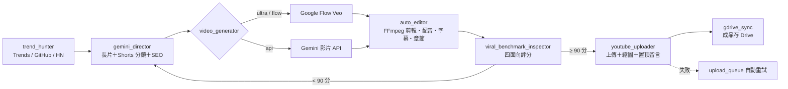

**一鍵安裝：[下載 ZIP](https://github.com/tonykfr1234/yt-auto-empire/archive/refs/heads/main.zip) → 全部解壓縮 → 雙擊 `INSTALL.bat`。**

<p align="center">
  <a href="README.md">English</a> · <strong>繁體中文</strong> · <a href="README.zh-CN.md">简体中文</a>
</p>

<p align="center"></p>
<h1 align="center">YouTube 爆款影片全自動產線</h1>
<p align="center">YT-Auto-Empire · 自動選題 → 寫腳本 → 生成影片 → 剪輯配音 → 品質審核 → 上傳 YouTube</p>
<p align="center">
  
  
  
  
  <a href="LICENSE"></a>
</p>
<p align="center">
  <a href="#advantages">優點</a> · <a href="#quick-start">快速開始</a> · <a href="#workflow">運作流程</a> · <a href="#features">功能</a> · <a href="#demo">示範</a> · <a href="#faq">常見問題</a> · <a href="#documentation">文件</a>
</p>

```powershell
python main_pipeline.py --engine ultra --long-scenes 32 --shorts-scenes 4
```

---

YT-Auto-Empire 是一條從頭到尾自動化的 YouTube 影片產線：自動從 Google Trends、GitHub Trending、Hacker News 找題目，讓 Gemini 當導演寫長片和 Shorts 雙版本分鏡，用 Google Flow（Veo）或 Gemini API 生成畫面，FFmpeg 自動剪輯、配音、上字幕和章節，最後經過品質審核，分數夠高才上傳到你的頻道。

本專案為非官方社群專案，與 Google、YouTube 沒有隸屬關係。

<a id="advantages"></a>
## 優點總整理

| 優點 | 說明 |
| --- | --- |
| 🔎 自動找題目 | Google Trends、GitHub Trending、Hacker News 輪流抓，發布過的主題自動跳過 |
| 🎬 一次出兩種版本 | 同一個主題同時產出 16:9 長片和 9:16 Shorts |
| 💎 把 Ultra 點數用好用滿 | `ultra` 模式優先消耗 Google Flow 點數，用完自動改走 Gemini API |
| 🧑‍🎤 原創 3D 主持人 | 24 組原創 3D 攝影棚場景，每支影片人物一致 |
| 🎙️ 自動配音與字幕 | 女聲旁白、整句不切斷的字幕、背景音樂、自動章節 |
| ✅ 四面向品質審核 | 內容、音樂、畫面、字幕四項評分，90 分以上才放行 |
| 📤 自動上傳與變現 | YouTube Data API 上傳縮圖、字幕、置頂留言與聯盟連結；失敗自動排隊重試 |
| ♾️ 24 小時常駐 | `daemon_24_7.py` 每 45 分鐘自動跑一輪，狀態即時寫入日誌 |
| ☁️ 成品同步 Drive | 長片、Shorts、專案包、檢閱資料夾自動分類存到 Google Drive |

<a id="quick-start"></a>
## 快速開始

1. 安裝 **Python 3.12 以上**（安裝時勾選 Add to PATH）。
2. [下載 ZIP](https://github.com/tonykfr1234/yt-auto-empire/archive/refs/heads/main.zip) 並全部解壓縮，雙擊 **`INSTALL.bat`**。它會安裝套件、Playwright 瀏覽器和 FFmpeg，並建立 `.env`。
3. 打開 `.env`，填入 `GEMINI_API_KEY` 和 `YOUTUBE_CHANNEL_EMAIL`。要自動上傳的話，另外放入 YouTube 的 `client_secrets.json`。
4. 雙擊 **`啟動_Google_Flow_專屬專案綁定.bat`**，在跳出的瀏覽器**自己登入 Google 一次**，之後就會記住。
5. 產出第一支影片：

```powershell
python main_pipeline.py                 # 只產片，不上傳
python main_pipeline.py --upload        # 審核通過後自動上傳
python daemon_24_7.py                   # 24 小時常駐模式
```

<a id="workflow"></a>
## 運作流程



<a id="features"></a>
## 功能

| 模組 | 行為 |
| --- | --- |
| `trend_hunter.py` | 從 Google Trends、GitHub Trending、Hacker News 挖高 CPM 題目 |
| `gemini_director.py` | 產出長片與 Shorts 分鏡、旁白、SEO 標題、說明欄、標籤 |
| `video_generator.py` | 雙引擎生成：Google Flow 網頁操控（Veo 最高畫質 1080p）或 Gemini API |
| `ultra_quota_maximizer.py` | 追蹤每月 Ultra 點數，依剩餘天數分配每日產量 |
| `auto_editor.py` | FFmpeg 混音、燒字幕、時間軸章節，輸出長片與 Shorts |
| `viral_broll_engine.py` | 3D 攝影棚場景、60fps 視差運鏡、玻璃擬態字幕 HUD |
| `viral_benchmark_inspector.py` | 內容／音樂／畫面／字幕四面向評分 |
| `self_critic_and_analytics.py` | 自我審查並把經驗寫進進化記憶，下次產片參考 |
| `youtube_uploader.py` | 官方 API 上傳；沒有憑證時改走 YouTube Studio 後台，失敗排隊重試 |
| `gdrive_sync.py` | 成品分類同步到 Google Drive |
| `daemon_24_7.py` | 24 小時常駐，每輪自動挑不重複主題 |

<a id="demo"></a>
## 示範

原創 3D 主持人攝影棚場景（`assets/studio_art/`，共 24 組）：


<a id="faq"></a>
## 常見問題

**Q：一定要 Google AI Ultra 嗎？**
不一定。`--engine api` 只用 Gemini API；`ultra` 和 `flow` 模式才需要能用 Google Flow 的帳號。

**Q：上傳失敗說 Chrome 被鎖定？**
你平常用的 Chrome 開著時，設定檔會被鎖住。程式會先把影片放進上傳佇列，之後自動重試，不會漏掉。

**Q：為什麼沒有自動上傳？**
預設只產片不上傳；要加 `--upload`，而且品質審核要 90 分以上才會放行。

**Q：上傳紀錄、點數帳本這些檔案去哪了？**
它們是本機執行狀態，含個人紀錄，已經不放進 GitHub。程式第一次執行會自動重新建立。

**Q：`.env` 會被上傳嗎？**
不會。`.env`、`token.json`、`client_secrets*.json` 都在 `.gitignore` 裡。

<a id="documentation"></a>
## 文件與檔案

```
yt-auto-empire/
├─ INSTALL.bat                          一鍵安裝
├─ 啟動_Google_Flow_專屬專案綁定.bat      第一次登入 Google
├─ main_pipeline.py                     主控台（單次產片）
├─ daemon_24_7.py                       24 小時常駐
├─ .env.example                         設定範本
├─ assets/studio_art/                   原創 3D 主持人場景
├─ skills/yt-auto-empire-character-drive/SKILL.md   AI 助手技能檔
└─ CHANGELOG.md                         更新記錄
```

- [更新記錄](CHANGELOG.md) · [貢獻指南](CONTRIBUTING.md) · [安全政策](SECURITY.md) · [AI 助手技能檔](skills/yt-auto-empire-character-drive/SKILL.md)

## 使用守則

- 只用你有權利使用的素材；主持人是原創設計，不模仿真人。
- 自動上傳前請確認標題、說明欄和聯盟連結符合 YouTube 政策與當地法規。
- 授權條款：[MIT](LICENSE)。

## 專有名詞解釋

| 名詞 | 正式定義 |
| --- | --- |
| Google Flow | Google 的 AI 影片創作工具，使用 Veo 模型依文字或圖片生成影片。 |
| Veo | Google DeepMind 開發的影片生成模型。 |
| Gemini API | Google 提供的生成式 AI 模型應用程式介面，可生成文字、圖片、語音與影片。 |
| YouTube Data API v3 | YouTube 官方提供的程式介面，可上傳影片、設定縮圖與字幕。 |
| Playwright | 微軟開源的瀏覽器自動化工具，可用程式操作 Chromium 等瀏覽器。 |
| FFmpeg | 開源的影音處理工具，用於轉檔、剪輯、混音與燒錄字幕。 |
| CPM（Cost Per Mille） | 每千次曝光的廣告收益，用來衡量題目的變現潛力。 |
| Shorts | YouTube 的直式短影音格式（9:16、60 秒以內）。 |

## 參考來源

- Google Flow：<https://labs.google/flow>
- Gemini API 文件：<https://ai.google.dev/gemini-api/docs>
- YouTube Data API v3：<https://developers.google.com/youtube/v3>
- Playwright：<https://playwright.dev/python/>
- FFmpeg：<https://ffmpeg.org/>
